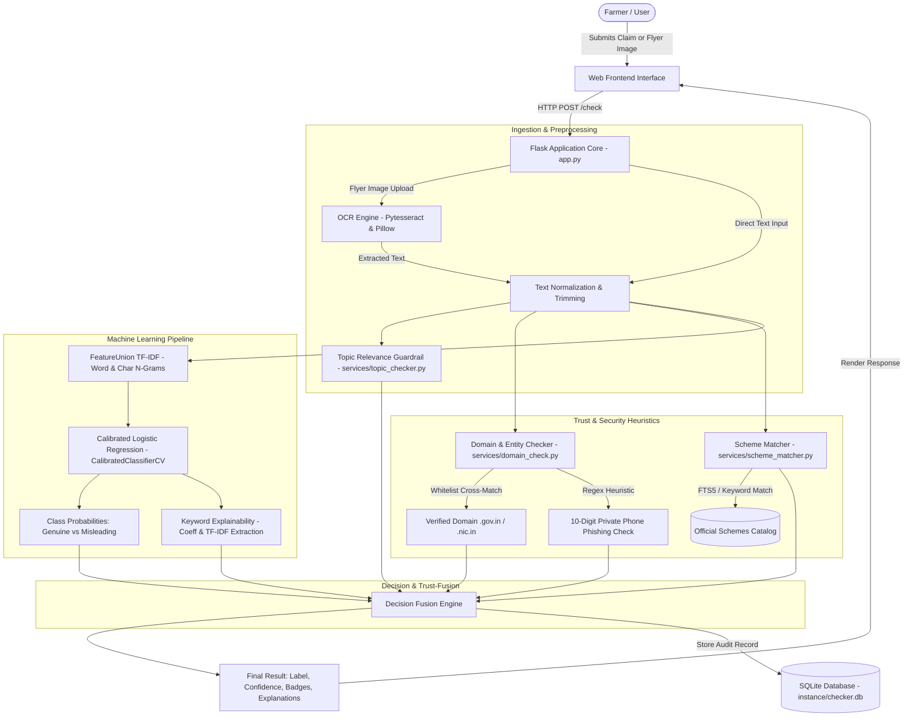
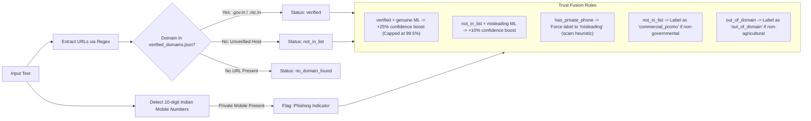

# AgriFact-Checker — Technical Design Document

This document provides a comprehensive technical overview of the **AgriFact-Checker** platform, including system architecture, machine learning workflows, database schemas, API routes, and trust-fusion domain verification logic.

---

## 1. System Architecture

The following diagram illustrates the end-to-end data flow from user interaction to validation, feature extraction, ML inference, trust fusion, and persistent storage:

---

## 2. Machine Learning Workflow

AgriFact-Checker employs an explainable, calibrated machine learning pipeline optimized for low-latency rural deployment without requiring heavy GPU infrastructure.

### A. Feature Extraction
- **Word TF-IDF Vectorizer:** Captures unigrams and bigrams (`ngram_range=(1, 2)`) with sublinear term-frequency scaling and stop-word filtering.
- **Character N-Gram Vectorizer:** Captures sub-word patterns (`ngram_range=(3, 5)`), providing resilience against spelling variations, typos, and transliterated Hinglish terms commonly found in WhatsApp messages.
- **Feature Union:** Combines both representations into a sparse matrix representations for classification.

### B. Classification & Probability Calibration
- **Base Classifier:** L2-regularized Logistic Regression (`C=1.0`, `solver='liblinear'`).
- **Probability Calibration:** Wrapped with `CalibratedClassifierCV(method='sigmoid', cv=3)`. This ensures that predicted probabilities reflect empirical reliability rather than extreme overconfident uncalibrated margins.
- **Metric Verification:** Evaluated against held-out agricultural test splits (`test.csv`, `val.csv`) and compared against a Multinomial Naive Bayes baseline.

### C. Explainability & Influential Terms
- For every prediction, the system extracts the word-level feature weights by computing the directional contribution:
  $$\text{Contribution}_i = \text{sign} \times (\text{Coeff}_i \times \text{TF-IDF}_i)$$
- The top contributing terms (e.g., `helpline`, `subsidy`, `official`, `portal`) are highlighted in the UI so farmers and field workers understand *why* a claim was flagged.

---

## 3. Domain Check & Trust-Fusion Flow

Misinformation often combines truthful text with a fraudulent link or unofficial registration phone number. AgriFact-Checker implements a trust-fusion pipeline:

---

## 4. SQLite Database Schema

The application uses an embedded SQLite database (`instance/checker.db`) managed via `services/database.py`.

### Table: `checks`
Stores all verification requests, predictions, and extracted metadata.

| Column | Type | Constraints | Description |
| :--- | :--- | :--- | :--- |
| `id` | `INTEGER` | PRIMARY KEY AUTOINCREMENT | Unique record identifier |
| `submitted_text` | `TEXT` | NOT NULL | Cleaned text of the submitted claim |
| `predicted_label` | `TEXT` | NOT NULL | Final label (`genuine`, `misleading`, `commercial_promo`, `out_of_domain`) |
| `confidence` | `REAL` | NOT NULL | Calibrated confidence score (percentage 0–100) |
| `influential_terms` | `TEXT` | NULLABLE | JSON string or comma-separated list of key explanation terms |
| `detected_domain` | `TEXT` | NULLABLE | Extracted host domain (e.g., `pmkisan.gov.in`) |
| `domain_status` | `TEXT` | NULLABLE | Whitelist status (`verified`, `not_in_list`, `no_domain_found`) |
| `created_at` | `TEXT` | NOT NULL | ISO 8601 UTC timestamp of check creation |

### Table: `feedback`
Stores community and user validation feedback for continuous model refinement.

| Column | Type | Constraints | Description |
| :--- | :--- | :--- | :--- |
| `id` | `INTEGER` | PRIMARY KEY AUTOINCREMENT | Unique feedback identifier |
| `check_id` | `INTEGER` | NOT NULL, FOREIGN KEY(`check_id`) REFERENCES `checks(id)` | Linked verification record |
| `vote` | `TEXT` | NOT NULL | `upvote` (helpful/correct) or `downvote` (incorrect) |
| `created_at` | `TEXT` | NOT NULL | ISO 8601 UTC timestamp of vote |

### Table: `schemes_search` (FTS5 Virtual Table)
Provides full-text search across official government agricultural schemes.

| Column | Type | Description |
| :--- | :--- | :--- |
| `name` | `TEXT` | Standard scheme title (e.g., `PM-KISAN`) |
| `name_hi` | `TEXT` | Hindi title for multilingual matching |
| `state` | `TEXT` | State jurisdiction or `Central` |
| `official_url` | `TEXT` | Verified government scheme portal URL |
| `description` | `TEXT` | Summary of scheme benefits and eligibility |
| `description_hi` | `TEXT` | Hindi summary description |
| `keywords` | `TEXT` | Comma-delimited trigger keywords for fuzzy matching |

---

## 5. Application Routes & API Endpoints

| Endpoint | Method | Input Parameters | Response / Behavior |
| :--- | :--- | :--- | :--- |
| `/` | `GET` | None | Renders main web UI (`index.html`) with recent 10 checks |
| `/check` | `POST` | `text` (form), `image` (file upload) | Executes OCR (if image), topic check, domain check, ML inference, trust fusion, saves result to SQLite, renders result card |
| `/feedback/<int:check_id>` | `POST` | `vote` (`upvote` or `downvote`) | Records user vote in `feedback` table; returns JSON `{"status": "success"}` |
| `/health` | `GET` | None | Verifies database connectivity and model status; returns JSON health report |
